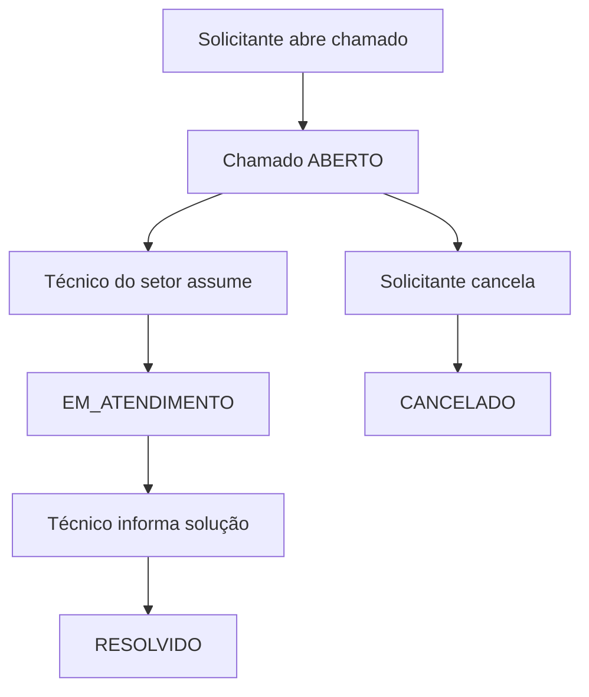
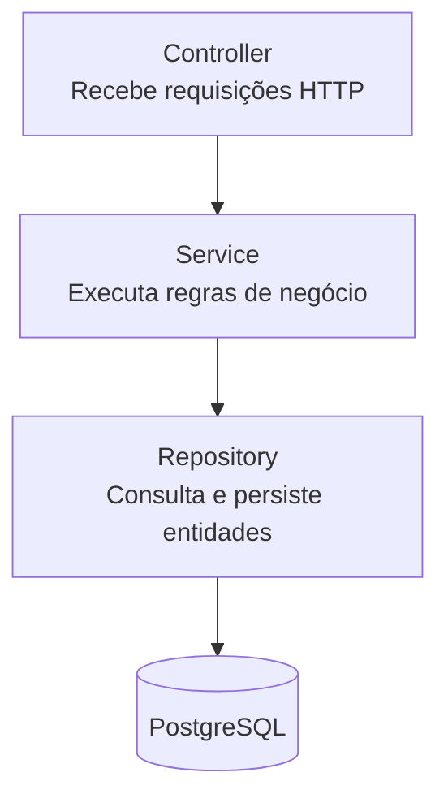
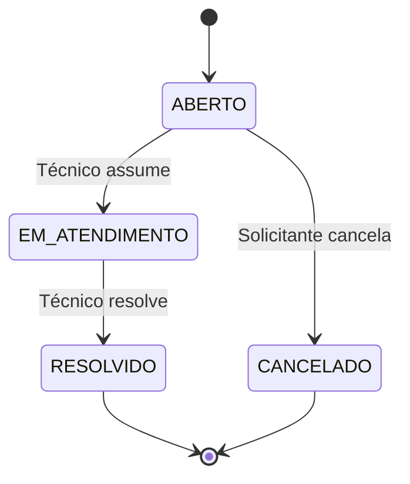

# Projeto API REST — Sistema de Chamados do IFRN

> **Disciplina:** Desenvolvimento de Sistemas Corporativos — IFRN 2026.2  
> **Objetivo:** implementar uma API REST simples com Spring Boot, seguindo a especificação da atividade, sem overengineering.

## 1. Visão geral do sistema

O sistema será uma central de suporte do IFRN, permitindo que alunos e servidores abram chamados para setores como TI e Manutenção. O foco da atividade é aplicar **arquitetura em camadas, JPA, migrations e Docker**.

### Fluxo principal

1. Um **solicitante** abre um chamado, informando título, descrição, local, categoria e, opcionalmente, prioridade.
2. O chamado nasce como `ABERTO`, com prioridade `MEDIA` por padrão e data de abertura preenchida pelo sistema.
3. Um **técnico do setor responsável pela categoria** assume o chamado, alterando o status para `EM_ATENDIMENTO`.
4. O solicitante e o técnico atribuído podem registrar interações.
5. O técnico responsável resolve o chamado, informando uma solução obrigatória e registrando a data de fechamento.
6. Alternativamente, o próprio solicitante pode cancelar um chamado enquanto estiver `ABERTO`.



**Fora do escopo:** autenticação, frontend, notificações e uploads. Como a especificação dispensa autenticação, o ID do usuário responsável pela ação é informado no corpo da requisição.

**Usuários do sistema:** serão inseridos automaticamente no banco por uma migration Flyway (seed). A API permitirá apenas consultar esses usuários; não haverá endpoints para criar, atualizar ou excluir usuários.

> **Alteração local da especificação:** esta decisão substitui, para este projeto, os requisitos do PDF referentes a `POST /usuarios` e `PUT /usuarios/{id}`. Os demais requisitos relacionados a usuários — entidade, seed, consultas e participação nos chamados — permanecem válidos.

**Convenção de código:** identificadores Java, nomes de classes, métodos, atributos, testes, pacotes e identificadores SQL serão escritos em inglês. A API preservará as rotas, os campos JSON e os valores de enum em português definidos pelo contrato, com exceção das chaves do JSON de erro, explicitamente padronizadas em inglês. O pacote-base será `com.ifrn.joaomanoelfontes.helpdesk`.

## 2. Tecnologias

| Tecnologia | Utilização |
| --- | --- |
| Java 21 | Linguagem |
| Spring Boot 4 | Framework |
| Spring Web | Endpoints REST |
| Spring Data JPA | Persistência |
| PostgreSQL | Banco de dados |
| Flyway | Versionamento do esquema do banco |
| Maven | Build e dependências |
| Docker / Docker Compose | Empacotamento e execução da API e do banco |
| Jakarta Validation | Validação de entradas (auxiliar) |
| Lombok | Redução de código repetitivo (opcional) |

Não utilizar Spring Security, JWT, MapStruct, Redis, RabbitMQ, microsserviços ou outras ferramentas sem necessidade.

## 3. Arquitetura do projeto

A aplicação será um **monólito tradicional em camadas**:



- **Controller:** recebe parâmetros e DTOs, chama o Service e devolve a resposta HTTP. Não contém regras de negócio.
- **Service:** aplica as regras, verifica permissões por tipo/ID de usuário, valida transições e lança exceções próprias.
- **Repository:** estende `JpaRepository` e implementa consultas com métodos derivados ou `@Query`.
- **Model:** contém as entidades JPA e seus relacionamentos.
- **DTO:** define os dados de entrada e saída, evitando expor entidades JPA diretamente.
- **Exception:** concentra as exceções e o tratamento global de erros.

Usar **injeção de dependência por construtor**, sem `@Autowired` em atributos.

### Estrutura de diretórios sugerida

```text
src/main/java/com/ifrn/joaomanoelfontes/helpdesk/
├── controller/
│   ├── SupportSectorController.java
│   ├── CategoryController.java
│   ├── UserController.java
│   └── TicketController.java
├── service/
│   ├── SupportSectorService.java
│   ├── CategoryService.java
│   ├── UserService.java
│   └── TicketService.java
├── repository/
│   ├── SupportSectorRepository.java
│   ├── CategoryRepository.java
│   ├── UserRepository.java
│   ├── TicketRepository.java
│   └── InteractionRepository.java
├── model/
│   ├── SupportSector.java
│   ├── Category.java
│   ├── User.java
│   ├── Ticket.java
│   ├── Interaction.java
│   └── enums/
│       ├── UserType.java
│       ├── Priority.java
│       └── TicketStatus.java
├── dto/
│   └── ...
├── exception/
│   ├── BusinessRuleException.java
│   ├── ResourceNotFoundException.java
│   └── GlobalExceptionHandler.java
└── HelpDeskApplication.java

src/main/resources/
├── application.properties
└── db/migration/
    ├── V1__create_tables.sql
    └── V2__insert_initial_data.sql

Dockerfile
docker-compose.yml
README.md
```

Não criar interfaces para todos os Services, casos de uso, adapters, factories ou outras abstrações que não sejam necessárias.

## 4. Modelagem dos dados

O domínio possui cinco entidades centrais.

| Entidade Java | Atributos Java mínimos | Relacionamentos |
| --- | --- | --- |
| `SupportSector` | `id`, `name`, `acronym` (única) | Um setor tem várias categorias e vários técnicos. |
| `Category` | `id`, `name`, `description` | Pertence a um setor. |
| `User` | `id`, `name`, `email` (único), `registration`, `type` | Técnico pertence a um setor. |
| `Ticket` | `id`, `title`, `description`, `location`, `priority`, `status`, `openedAt`, `closedAt`, `solution` | Tem solicitante, categoria e, opcionalmente, técnico. |
| `Interaction` | `id`, `text`, `createdAt` | Pertence a um chamado e tem autor (`User`). |

Os DTOs mapearão esses atributos internos para os nomes externos em português definidos pela API, como `nome`, `sigla`, `matricula`, `titulo`, `dataAbertura` e `dataFechamento`.

Sugestões simples de implementação:

- `Long` para IDs.
- `LocalDateTime` para datas e horários.
- `@ManyToOne` e `@OneToMany` para relacionamentos.
- `@Enumerated(EnumType.STRING)` para enums.
- `@Column(unique = true)` para `SupportSector.acronym` e `User.email`, além de restrições correspondentes no banco.

### Enums

- `UserType`: `SOLICITANTE`, `TECNICO`.
- `Priority`: `BAIXA`, `MEDIA`, `ALTA`.
- `TicketStatus`: `ABERTO`, `EM_ATENDIMENTO`, `RESOLVIDO`, `CANCELADO`.

Os nomes dos tipos são internos e ficam em inglês. Os valores permanecem em português porque fazem parte do contrato da API e da especificação.

### Ciclo de vida do chamado

As **únicas transições permitidas** são:



Não usar uma biblioteca de máquina de estados. As verificações podem ficar diretamente nos métodos do `TicketService`.

## 5. Regras de negócio obrigatórias

**Todas estas regras devem ser implementadas na camada Service:**

1. Todo chamado nasce `ABERTO`, com `dataAbertura` preenchida pelo sistema e prioridade `MEDIA` quando não informada.
2. Apenas usuários `SOLICITANTE` podem abrir chamados.
3. Um técnico só pode assumir um chamado `ABERTO` cuja categoria pertença ao seu setor. Ao assumir, o status se torna `EM_ATENDIMENTO`.
4. Somente o técnico atribuído pode resolver o chamado. A solução é obrigatória e o sistema deve preencher `dataFechamento`.
5. Somente o solicitante do próprio chamado pode cancelá-lo, e apenas no status `ABERTO`.
6. Chamados `RESOLVIDO` ou `CANCELADO` não aceitam alterações nem novas interações.
7. Apenas o solicitante e o técnico atribuído podem registrar interações.
8. Não é permitido excluir uma categoria que tenha chamados vinculados. Um setor não pode ser excluído enquanto possuir categorias, técnicos ou chamados relacionados.

As verificações de exclusão devem ocorrer na camada Service antes da chamada a `delete`. As chaves estrangeiras continuam no banco para garantir integridade referencial, mas a API não deve depender de uma violação de constraint: a regra deve produzir `409 Conflict` de forma controlada antes da tentativa de exclusão.

O ID do usuário que executa a ação será recebido no corpo da requisição, pois não há autenticação.

### Exemplo de lógica no Service

Exemplo **ilustrativo** (não é uma implementação completa):

```java
@Transactional
public Ticket assign(Long ticketId, Long technicianId) {
    // Buscar chamado e usuário técnico
    // Verificar status ABERTO
    // Verificar se o usuário é TECNICO
    // Verificar se o técnico pertence ao setor da categoria
    // Atribuir técnico
    // Alterar status para EM_ATENDIMENTO
    // Salvar e retornar
}
```

Não é preciso aplicar Strategy ou State Pattern para esse fluxo.

## 6. Endpoints obrigatórios

### Cadastros básicos

| Recurso | Método | Rota | Observação |
| --- | --- | --- | --- |
| Setores | `POST` | `/setores` | Cadastrar. |
| Setores | `GET` | `/setores` | Listar com paginação e filtro. |
| Setores | `GET` | `/setores/{id}` | Buscar por ID. |
| Setores | `PUT` | `/setores/{id}` | Atualizar. |
| Setores | `DELETE` | `/setores/{id}` | Bloquear no Service se houver categorias, técnicos ou chamados relacionados. |
| Categorias | `POST` | `/categorias` | Cadastrar. |
| Categorias | `GET` | `/categorias` | Listar com paginação e filtros. |
| Categorias | `GET` | `/categorias/{id}` | Buscar por ID. |
| Categorias | `PUT` | `/categorias/{id}` | Atualizar. |
| Categorias | `DELETE` | `/categorias/{id}` | Bloquear no Service se houver chamados vinculados. |
| Categorias | `GET` | `/setores/{id}/categorias` | Listar categorias do setor, com paginação. |
| Usuários | `GET` | `/usuarios` | Listar os usuários do seed, com paginação e filtros. |
| Usuários | `GET` | `/usuarios/{id}` | Buscar por ID. |

Os usuários são dados de referência mantidos pelo seed. Portanto, não existirão `POST`, `PUT`, `PATCH` ou `DELETE` para `/usuarios`.

### Chamados e interações

| Método | Rota | Ação | Sucesso |
| --- | --- | --- | --- |
| `POST` | `/chamados` | Abrir chamado. | `201` |
| `GET` | `/chamados` | Listar chamados paginados e filtrados. | `200` |
| `GET` | `/chamados/{id}` | Detalhar chamado com interações. | `200` |
| `GET` | `/usuarios/{id}/chamados` | Listar chamados abertos pelo solicitante ou atribuídos ao técnico. | `200` |
| `PATCH` | `/chamados/{id}/assumir` | Técnico assume chamado. | `200` |
| `PATCH` | `/chamados/{id}/resolver` | Técnico informa solução e resolve. | `200` |
| `PATCH` | `/chamados/{id}/cancelar` | Solicitante cancela. | `200` |
| `POST` | `/chamados/{id}/interacoes` | Adicionar interação. | `201` |

## 7. Paginação e filtros

Toda rota `GET` que retorna coleção deve ser paginada e aceitar os filtros opcionais aplicáveis.

- Usar `Pageable` do Spring Data JPA.
- Aceitar os parâmetros `page`, `size` e `sort`.
- Tamanho padrão: **10** itens; máximo: **50**.
- Retornar os itens e metadados: página, tamanho, total de elementos e total de páginas.
- Permitir combinar filtros; os não informados são ignorados.

| Listagem | Filtros mínimos |
| --- | --- |
| `GET /setores` | `nome` (contém, ignorando maiúsculas/minúsculas). |
| `GET /categorias` | `nome`, `setorId`. |
| `GET /usuarios` | `nome`, `tipo`, `setorId`. |
| `GET /chamados` | `status`, `prioridade`, `setorId`, `categoriaId`, `solicitanteId`, `tecnicoId`, `dataInicio`, `dataFim`. |
| `GET /usuarios/{id}/chamados` | `status`. |

As demais rotas de listagem também devem respeitar a exigência geral de paginação.

Exemplo:

```http
GET /chamados?status=ABERTO&setorId=1&prioridade=ALTA&page=0&size=10&sort=dataAbertura,desc
```

**Abordagem sugerida:** `Pageable` e consultas `@Query` com parâmetros opcionais. Evitar QueryDSL ou infraestruturas genéricas de filtros para um projeto deste porte.

## 8. Tratamento de erros e validações

| Código | Quando utilizar |
| --- | --- |
| `400 Bad Request` | Dados inválidos ou campos obrigatórios vazios. |
| `404 Not Found` | Recurso inexistente. |
| `409 Conflict` | Violação de regra de negócio, transição de status inválida ou técnico de outro setor. |

Exceções:

- `ResourceNotFoundException` → `404`.
- `BusinessRuleException` → `409`.
- Exceções de validação de entrada → `400`.

Centralizar o tratamento com `@RestControllerAdvice` e retornar sempre JSON com as chaves em inglês `timestamp`, `status`, `message` e `path`.

Exemplo ilustrativo:

```json
{
  "timestamp": "2026-10-27T14:30:00",
  "status": 409,
  "message": "Técnico não pertence ao setor da categoria",
  "path": "/chamados/1/assumir"
}
```

## 9. Persistência e migrations

- Configurar a conexão PostgreSQL por **variáveis de ambiente**, sem senha fixa em `application.properties`.
- Usar Flyway para criar e evoluir o esquema.
- Definir `spring.jpa.hibernate.ddl-auto=validate`, para que o Hibernate valide o esquema sem criar tabelas.
- Guardar migrations em `src/main/resources/db/migration`.
- Criar uma nova migration para cada mudança, sem editar versões já aplicadas.

Migrations iniciais:

1. `V1__create_tables.sql`: estrutura do banco, chaves e restrições.
2. `V2__insert_initial_data.sql`: seed com pelo menos **2 setores, 4 categorias e 4 usuários** (incluindo solicitantes e técnicos ligados aos respectivos setores).

O seed é aplicado automaticamente pelo Flyway ao subir a aplicação com um banco novo, sem depender de `CommandLineRunner` ou de chamadas HTTP. Ele será a única forma de cadastrar usuários no escopo do projeto; a API disponibilizará apenas consultas de usuários.

No `README.md`, incluir uma explicação breve sobre:

- como o Flyway registra versões em `flyway_schema_history`;
- o que ocorre quando o checksum de uma migration já aplicada muda;
- por que `ddl-auto=update` não é a opção recomendada para produção.

## 10. Infraestrutura, containerização e CI

Esta parte deve ser implementada **depois que a API e suas regras de negócio estiverem funcionando**. Assim, problemas de domínio e problemas de infraestrutura são tratados separadamente.

Criar:

- **Dockerfile multi-stage:** Maven compila a aplicação; uma imagem com JRE executa o `.jar`.
- **`docker-compose.yml`:** sobe a API e o PostgreSQL, com volume para persistir dados.
- **Healthcheck/dependência de prontidão:** a API deve iniciar após o banco estar disponível.
- **CI com GitHub Actions:** executar a compilação e os testes a cada `push` e `pull request`.

O requisito de execução é:

```bash
docker compose up
```

Depois disso, a API deve responder em **http://localhost:8080**, sem instalação local de Java, Maven ou PostgreSQL.

## 11. Passo a passo de desenvolvimento

As etapas abaixo estão na ordem recomendada. Cada etapa deve terminar com a aplicação compilando e, quando já houver comportamento testável, com os testes correspondentes passando.

### Status verificado em 28/10/2026

| Etapa | Status | Evidência no repositório |
| --- | --- | --- |
| 1 — Base da aplicação | **Concluída** | Dependências, Java 21, Maven Wrapper, pacotes, datasource por variáveis de ambiente e `ddl-auto=validate` configurados. |
| 2 — Domínio e persistência | **Concluída** | Cinco entidades, enums, relacionamentos, repositories e migrations `V1`/`V2` presentes. |
| 3 — Componentes comuns | **Concluída** | DTOs, paginação, validação, exceções e tratamento global implementados. |
| 4 — Setores e categorias | **Concluída** | CRUDs, filtros, paginação, consulta por setor e conflitos de exclusão implementados e testados. |
| 5 — Consultas de usuários | **Concluída** | API somente leitura, filtros, paginação e busca por ID implementados e testados. |
| 6 — Abertura e consulta de chamados | **Concluída** | Abertura, valores padrão, listagem e detalhamento com histórico implementados. |
| 7 — Ciclo de vida do chamado | **Concluída** | Assunção, resolução, cancelamento e rejeição das transições inválidas implementados e testados. |
| 8 — Interações | **Concluída** | Autorização, data automática, bloqueio após finalização e histórico cronológico implementados e testados. |
| 9 — Filtros e paginação | **Concluída** | Filtros opcionais e combináveis, ordenação e limite de 50 implementados; listagens com e sem filtros validadas contra PostgreSQL. |
| 10 — Revisão e documentação | **Concluída** | Contratos HTTP, `README.md`, `api.http` e explicação sobre Flyway presentes; `./mvnw test` executado com 38 testes aprovados. |
| 11 — Containerização | **Concluída** | Dockerfile multi-stage e `compose.yaml` com API, PostgreSQL, volume, healthcheck e dependência de prontidão implementados e validados. |
| 12 — CI e entrega | **Parcial** | GitHub Actions configurado para executar `./mvnw clean verify` com Java 21 e cache Maven em pushes e pull requests da `main`; verificações finais de repositório e entrega continuam pendentes. |

### Etapa 1 — Preparar a base da aplicação ✅

1. Revisar o `pom.xml` e adicionar Spring Web, Spring Data JPA, PostgreSQL, Flyway e Jakarta Validation.
2. Manter Java 21, Spring Boot 4 e Maven Wrapper.
3. Criar os pacotes `controller`, `service`, `repository`, `model`, `dto` e `exception`.
4. Configurar o datasource por variáveis de ambiente e definir `spring.jpa.hibernate.ddl-auto=validate`.
5. Confirmar que o projeto compila antes de implementar funcionalidades.

Nesta etapa ainda não é necessário criar Dockerfile, Compose ou workflow de CI.

### Etapa 2 — Criar o domínio e a persistência ✅

1. Criar os enums `UserType`, `Priority` e `TicketStatus`.
2. Criar as entidades `SupportSector`, `Category`, `User`, `Ticket` e `Interaction`.
3. Mapear os relacionamentos com `@ManyToOne` e `@OneToMany` e persistir enums como texto.
4. Criar os cinco repositories estendendo `JpaRepository`.
5. Criar `V1__create_tables.sql` com tabelas, chaves estrangeiras, campos obrigatórios e restrições de unicidade.
6. Criar `V2__insert_initial_data.sql` com pelo menos 2 setores, 4 categorias e 4 usuários.
7. Validar que as migrations e os mapeamentos JPA são compatíveis.

Ao concluir, o modelo de dados deve estar pronto e os usuários necessários para testar a API devem existir no seed.

### Etapa 3 — Preparar os componentes comuns da API ✅

1. Criar DTOs de entrada e saída sem expor diretamente as entidades JPA.
2. Criar uma resposta padronizada para paginação com itens e metadados.
3. Criar `ResourceNotFoundException` e `BusinessRuleException`.
4. Criar o `GlobalExceptionHandler` com respostas `400`, `404` e `409`.
5. Aplicar Jakarta Validation aos DTOs de entrada.
6. Configurar paginação com tamanho padrão 10 e máximo 50.

Esses componentes devem ser pequenos e reutilizados pelos endpoints seguintes.

### Etapa 4 — Implementar setores e categorias ✅

1. Implementar `SupportSectorService` e `SupportSectorController`.
2. Implementar cadastro, busca por ID, atualização, exclusão e listagem paginada de setores.
3. Implementar o filtro de setor por nome, sem diferenciar maiúsculas e minúsculas.
4. Implementar `CategoryService` e `CategoryController`.
5. Implementar cadastro, busca por ID, atualização, exclusão e listagem paginada de categorias.
6. Implementar os filtros por nome e setor.
7. Implementar `GET /setores/{id}/categorias`.
8. No Service, impedir a exclusão de categoria com chamados e de setor com categorias, técnicos ou chamados relacionados.
9. Criar testes para os fluxos válidos, recursos inexistentes e conflitos de exclusão.

Essa etapa entrega os primeiros CRUDs funcionais da API.

### Etapa 5 — Implementar consultas de usuários ✅

1. Implementar `UserService` e `UserController` somente para leitura.
2. Implementar `GET /usuarios` com paginação e filtros por nome, tipo e setor.
3. Implementar `GET /usuarios/{id}`.
4. Confirmar que não existem endpoints para criar, atualizar ou excluir usuários.
5. Criar testes para consultas e usuário inexistente.

Os usuários continuam sendo criados exclusivamente pela migration de seed.

### Etapa 6 — Implementar a abertura e a consulta de chamados ✅

1. Criar os DTOs específicos de abertura e resposta de chamado.
2. Implementar `POST /chamados`.
3. Validar que somente um `SOLICITANTE` pode abrir chamado.
4. Preencher automaticamente status `ABERTO`, data de abertura e prioridade `MEDIA` quando ela não for informada.
5. Implementar `GET /chamados/{id}` com as interações em ordem cronológica.
6. Implementar inicialmente `GET /chamados` paginado, mesmo antes de adicionar todos os filtros.
7. Criar testes para abertura válida, solicitante inválido e recursos inexistentes.

### Etapa 7 — Implementar o ciclo de vida do chamado ✅

1. Implementar `PATCH /chamados/{id}/assumir`.
2. Validar tipo e setor do técnico e permitir apenas chamados `ABERTO`.
3. Implementar `PATCH /chamados/{id}/resolver`.
4. Exigir solução, validar o técnico atribuído e preencher a data de fechamento.
5. Implementar `PATCH /chamados/{id}/cancelar`.
6. Permitir o cancelamento somente pelo solicitante enquanto o chamado estiver `ABERTO`.
7. Bloquear qualquer transição não prevista no ciclo de vida.
8. Criar testes para cada transição válida e inválida.

### Etapa 8 — Implementar interações ✅

1. Implementar `POST /chamados/{id}/interacoes`.
2. Permitir interação somente pelo solicitante ou pelo técnico atribuído.
3. Preencher automaticamente a data e a hora.
4. Bloquear interações em chamados `RESOLVIDO` ou `CANCELADO`.
5. Garantir que o detalhamento do chamado apresente todo o histórico.
6. Criar testes de autorização por ID e de chamados finalizados.

### Etapa 9 — Completar filtros e paginação ✅

1. Implementar em `GET /chamados` os filtros combináveis por status, prioridade, setor, categoria, solicitante, técnico e período de abertura.
2. Implementar `GET /usuarios/{id}/chamados` com filtro opcional por status.
3. Conferir `page`, `size` e `sort` em todas as rotas que retornam coleções.
4. Validar o tamanho máximo de 50 itens.
5. Criar testes combinando mais de um filtro e cobrindo páginas vazias.

### Etapa 10 — Revisar e documentar a API ✅

1. Conferir todos os códigos HTTP e o formato padronizado dos erros.
2. Executar a suíte completa de testes e corrigir regras inconsistentes.
3. Criar uma coleção Postman/Insomnia ou um arquivo `.http` com todas as requisições.
4. Escrever o `README.md` com descrição, execução, usuários do seed e exemplos de uso.
5. Explicar no README o histórico e o checksum do Flyway e o motivo de não usar `ddl-auto=update` em produção.

### Etapa 11 — Containerizar a aplicação ✅

1. Criar um Dockerfile multi-stage com compilação Maven e execução em JRE.
2. Criar `docker-compose.yml` com API, PostgreSQL e volume persistente.
3. Passar as configurações do banco para a API por variáveis de ambiente.
4. Adicionar healthcheck ao PostgreSQL e dependência de prontidão para a API.
5. Testar o projeto a partir de um ambiente limpo com `docker compose up --build`.
6. Confirmar que a API responde em `http://localhost:8080` sem configuração manual.

### Etapa 12 — Adicionar integração contínua e preparar a entrega 🚧

1. Criar um workflow do GitHub Actions executado em `push` e `pull_request`.
2. Configurar Java 21 e cache do Maven no workflow.
3. Disponibilizar PostgreSQL como serviço da execução, caso os testes de contexto ou integração precisem do banco.
4. Executar `./mvnw verify` na CI.
5. Opcionalmente, validar também a construção da imagem Docker.
6. Verificar se o histórico possui commits distribuídos pelas etapas do desenvolvimento.
7. Fazer uma última execução de `docker compose up --build` e das requisições de exemplo antes da entrega.

## 12. O que evitar (sem overengineering)

- Autenticação, JWT, telas, dashboard, notificações, envio de e-mails ou anexos não solicitados.
- Interfaces `IService` e implementações `ServiceImpl` para todos os serviços sem necessidade.
- Arquitetura hexagonal, CQRS, Event Sourcing, microsserviços e múltiplos módulos Maven.
- Máquina de estados genérica para as três transições permitidas.
- QueryDSL/Specifications complexas se `@Query` for suficiente.
- Excesso de DTOs, mapeadores ou padrões para operações simples.

A prioridade é **cumprir as regras e os endpoints pedidos**, não acrescentar funcionalidades.

## 13. Checklist de aderência à especificação

- [x] Cinco entidades, atributos e relacionamentos obrigatórios.
- [x] Enums e transições de status corretos.
- [x] Oito regras de negócio implementadas no Service.
- [x] Exclusões validadas preventivamente no Service, retornando `409` sem depender de erro do banco.
- [x] Todos os endpoints obrigatórios, com seus métodos e códigos de sucesso.
- [x] Paginação e filtros nas rotas de listagem, tamanho padrão 10 e máximo 50.
- [x] Erros `400`, `404` e `409`, com as chaves `timestamp`, `status`, `message` e `path`.
- [x] Java 21, Spring Boot 4, Spring Web, Spring Data JPA e PostgreSQL.
- [x] Injeção por construtor e repositories com `JpaRepository`.
- [x] Flyway, seed inicial (2 setores, 4 categorias, 4 usuários) e `ddl-auto=validate`.
- [x] Usuários criados exclusivamente pelo seed, sem endpoints de criação, atualização ou exclusão.
- [x] Consultas `GET /usuarios` e `GET /usuarios/{id}` disponíveis para identificar os usuários do seed.
- [x] Consulta `GET /usuarios/{id}/chamados` mantida com paginação e filtro por status.
- [x] Configuração do banco por variáveis de ambiente.
- [x] Dockerfile multi-stage e Docker Compose com API, PostgreSQL e volume.
- [x] `docker compose up` disponibiliza a API em `localhost:8080`.
- [x] GitHub Actions executa compilação e testes em `push` e `pull_request` destinados à `main`.
- [x] README com descrição, execução, requisições e explicação solicitada sobre migrations.
- [x] Coleção Postman/Insomnia ou `.http` com todas as requisições da especificação.
- [ ] Repositório público com commits distribuídos ao longo do desenvolvimento.
- [ ] Entrega do link pelo Google Sala de Aula; avaliação do último commit da `main`.

---

## 14. Recomendação final

A arquitetura **Controller → Service → Repository → PostgreSQL** é suficiente para este projeto. Concentrar o maior cuidado no `TicketService`, nos filtros/paginação e na configuração Flyway/Docker. O objetivo é produzir uma API simples, fácil de explicar e fiel ao documento da disciplina.

> **Nota:** este arquivo é um overview de implementação. O PDF oficial **Projeto API REST — Sistema de Chamados do IFRN** continua sendo a referência para os demais requisitos, respeitando as decisões locais explicitadas neste documento sobre usuários somente leitura, identificadores internos em inglês, formato dos erros e validação de exclusões no Service.
